# ioNova AI Lab: App User Guide

2 November 2026 · Vilas Menon

> Exported from the Claude Docs page [ioNova AI Lab: App User Guide](https://claude.ai/artifact/KQW4NBsxLggbemrWvBj5Qs). Screenshots were taken in the dev environment on 2 Nov 2026.

This guide walks through both ioNova Fabric apps screen by screen: App A structures postal addresses with the existing Foundry agent, and App B proves that apps stay separate.

## The two apps at a glance

App A turns a free-text postal address into six checked fields using the existing Foundry agent; App B is a small second app that proves apps stay apart.

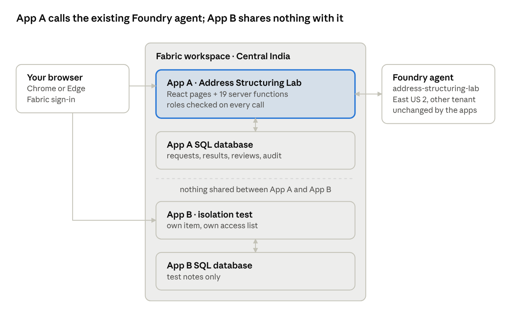

Only App A's server functions talk to the agent: they send the address text and save the answer in App A's own database. App B has its own item, database and access list, and nothing links it to App A.

## Open and sign in

Both apps are private web pages hosted by Microsoft Fabric; you sign in with your ioNova work account.

| App | URL (dev) |
| --- | --- |
| App A, Address Structuring Lab | [hot-shrub-288d05cfbd-centralindia.webapp.fabricapps.net](https://hot-shrub-288d05cfbd-centralindia.webapp.fabricapps.net) |
| App B, isolation test | [satin-gorge-cc665081ef-centralindia.webapp.fabricapps.net](https://satin-gorge-cc665081ef-centralindia.webapp.fabricapps.net) |

1. Open the app URL in Chrome or Edge.
2. Select **Sign in**. A Microsoft Fabric tab opens.
3. Pick your ioNova account (for example vilas@ionova.ai) and finish any MFA prompt. The Fabric tab closes and the app opens.
4. Your email and roles appear at the top right. **Sign out** ends the session.

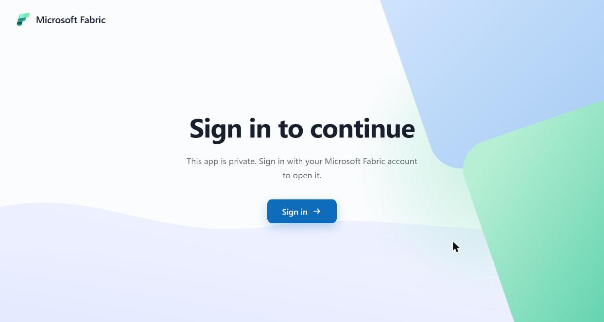

A personal Microsoft account (gmail, outlook) cannot open the apps. You also need the app item shared with you in Fabric (**Run and interact**) and, for App A, a role granted inside the app.

## Roles

What you see in App A depends on the roles an app admin granted you; one person can hold several roles, and nobody can change their own roles.

| Role | Can do | Tabs you see |
| --- | --- | --- |
| app\_user | Submit addresses, see and retry own requests | Structure an address, Records |
| reviewer | See all requests, approve, reject or correct fields | Records (all) |
| auditor | Read the audit trail and verify its integrity | Audit |
| audit\_exporter | Read and export the audit trail | Audit |
| app\_admin | Grant and revoke roles, run operations checks | Administration |
| super\_user (dev/uat only) | app\_user plus app\_admin, so one person can check the system alone | Structure an address, Records, Administration |

The screenshots in this guide were taken as vilas@ionova.ai with **app admin** and **super user**, so the Review and Audit screens are described but not shown. An app admin sees no address data or audit entries unless they also hold those roles.

## First-time setup (app admin)

A new deployment needs one admin and a few readiness checks before anyone submits addresses; this was done in dev on 26 Oct 2026.

1. Sign in as an account listed in the deployment's bootstrap admins. On the **No access to this app yet** page, select **Become the first app administrator**.
2. Open **Administration**. Scroll to **Operations and readiness**.
3. Select **Seed sample data** once. It loads six approved synthetic addresses for the sample picker.
4. Select **Run diagnostics**. It lists the app's settings and a green tick for each database table.
5. Select **Probe existing Foundry agent**. Expect *reachable, contract valid*; it proves the app can call the agent.
6. Optional: **Run evaluation (6 live calls)** sends the six samples to the agent and compares the answers with the expected fields.

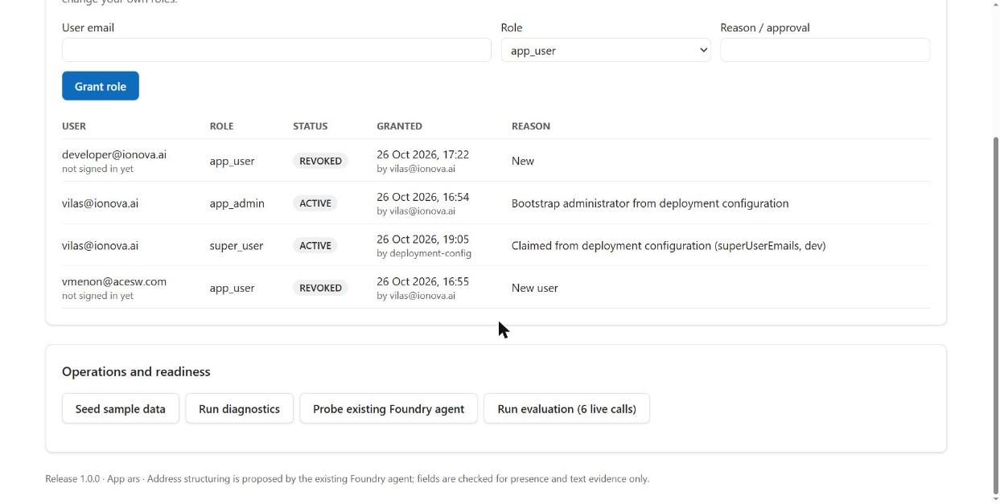

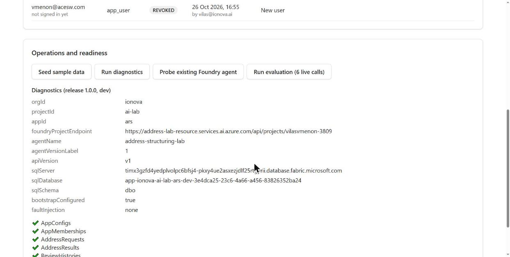

If the probe shows *auth (HTTP 403)*, the Foundry role is missing or still propagating (up to about 15 minutes).

## Structure an address

You paste one free-text address; the existing Foundry agent splits it into six fields, and the app saves both your input and the result (about 10–15 seconds).

1. Open **Structure an address** (the first tab).

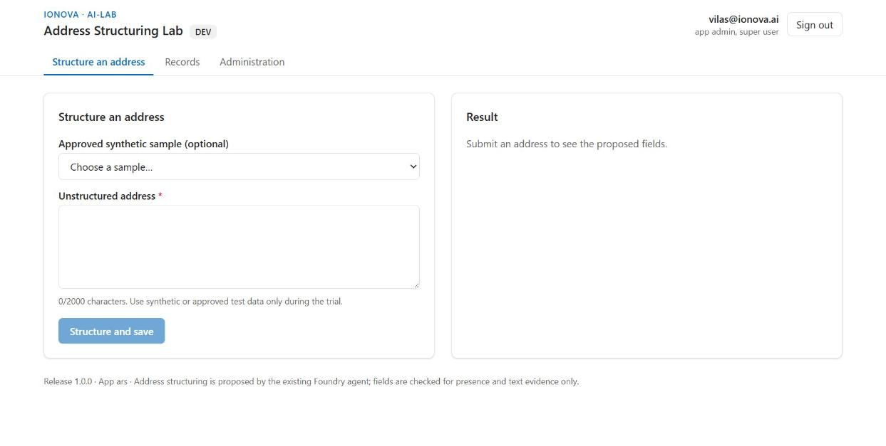

2. Either pick an entry from **Approved synthetic sample**, or type an address into **Unstructured address** (up to 2,000 characters). During the trial, use synthetic or approved test data only.

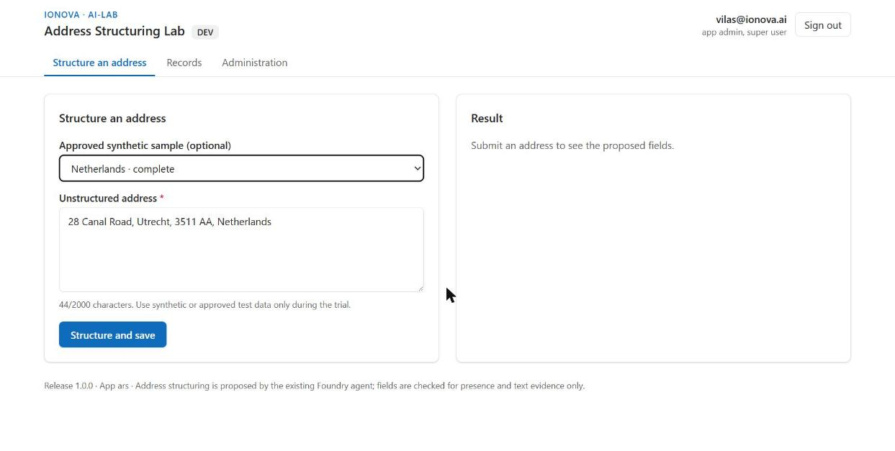

3. Select **Structure and save**. The button shows *Structuring… (this can take up to a minute)* while the agent works.

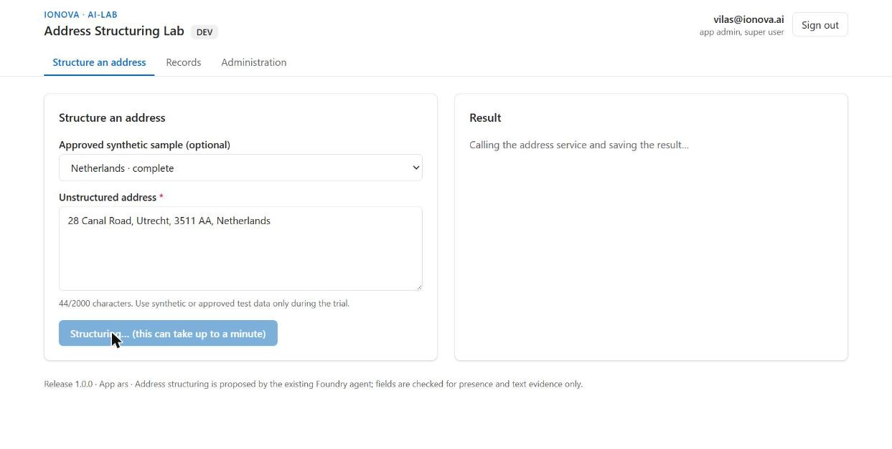

4. Read the **Result**: Building, Street, Town / city, Region, Postcode and Country (ISO), each with the words from your input that support it. A dash means the agent found nothing for that field.

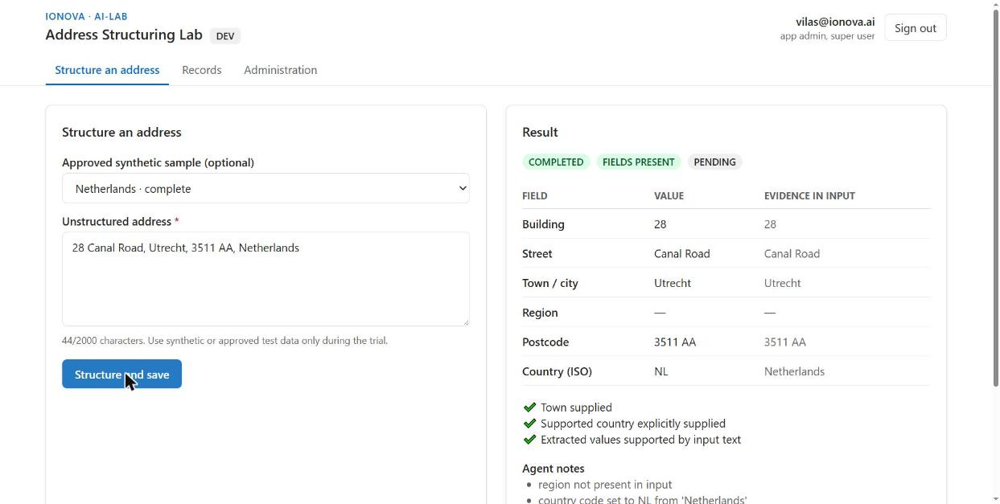

5. Check the badges and ticks. **COMPLETED** means it was saved, **FIELDS PRESENT** means the result passed the app's checks, and **PENDING** means no reviewer has looked at it yet. Below them are the agent's notes, the time taken and a **Correlation ID** for support.
6. Select **Open record** to see the saved record.

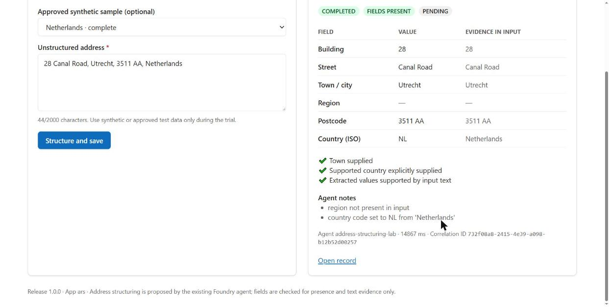

## Records and record details

Every submission becomes a record that keeps your original input, the agent's untouched output and the current (reviewed) fields side by side.

1. Open **Records**. Filter by **Processing** (for example COMPLETED or FAILED\_AI) and **Review** (PENDING, APPROVED, REJECTED, NEEDS\_CHANGES). App users see their own records; reviewers see everyone's.

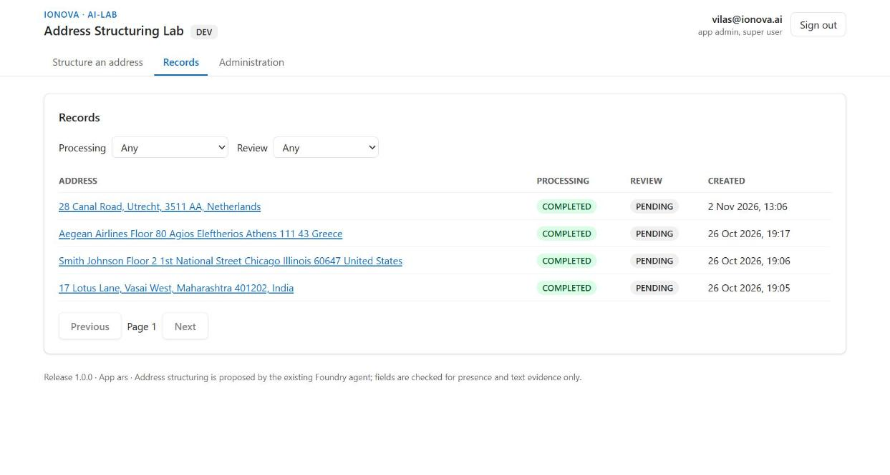

2. Open a record (from the list, or **Open record** after a submission). The top card shows the status badges, version, original input, who submitted it, when, and the correlation ID.

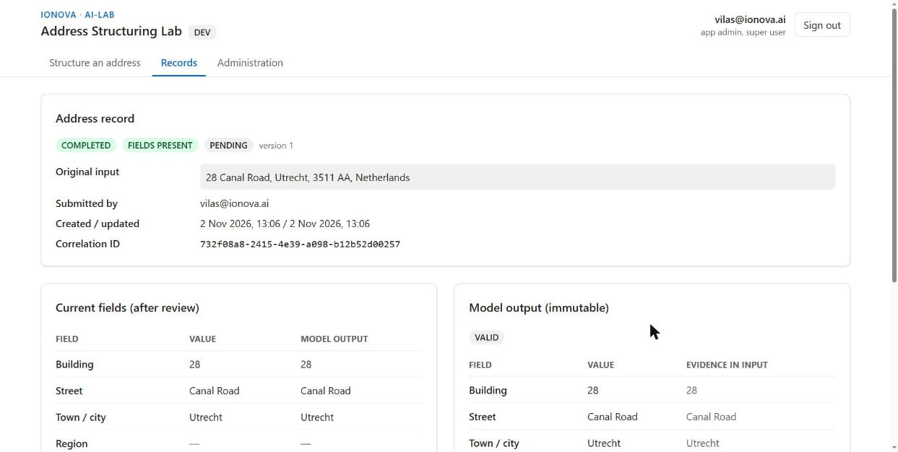

3. Compare the two panels. **Current fields (after review)** is what the business uses; **Model output (immutable)** is the agent's answer, never edited, with the agent version, contract and response ID. **Review history** lists every reviewer decision.

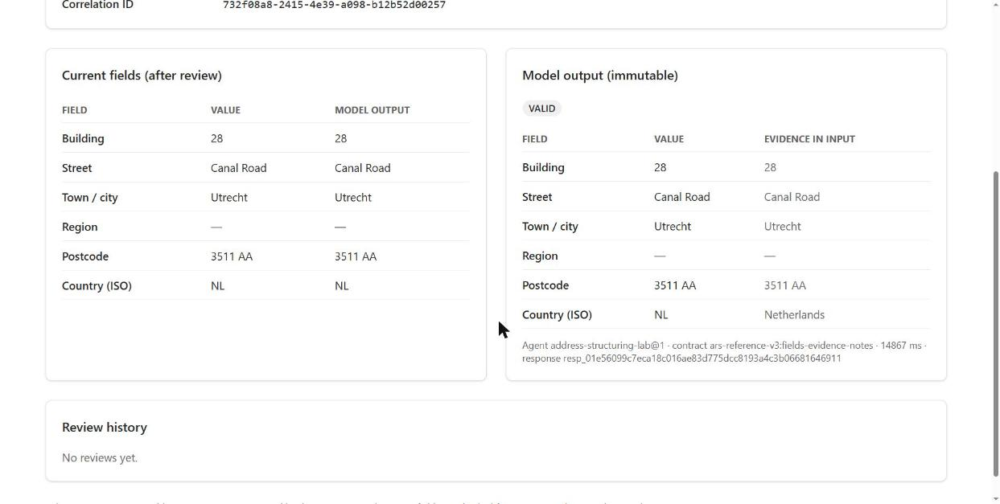

## Review a result (reviewer)

A reviewer confirms or corrects the agent's fields; the agent's original output is never changed, only the current fields and the review history.

1. Open **Records** and filter **Review** to **PENDING**.
2. Open a record. Below the panels shown above, a **Review** card appears for reviewers.
3. Under **Corrected fields (leave unchanged to keep)**, edit any of the six fields. Country takes a two-letter ISO code.
4. Choose a **Decision**: Approve, Needs changes, Reject or Comment only. Add **Comments** if useful.
5. Select **Save review (version N)**. The record's review badge and **Review history** update.
6. If someone else saved first, you see a conflict message. Select **Reload latest version** and review again.

No screenshot: the sample account does not hold the reviewer role.

## Audit trail (auditor)

Every business action is written to a tamper-evident audit trail: each event carries a hash of the one before it, so any change or gap shows up when you verify it. Audit events never contain address text.

1. Open the **Audit** tab (shown only to auditor and audit\_exporter).
2. Narrow the list with **Actor email**, **Action** (for example address.processed) and **Outcome** (SUCCESS, DENIED, FAILURE), then select **Apply filters**.
3. Read the table: **Time (local)**, **Actor**, **Action**, **Object**, **Outcome** and **Correlation ID**.
4. Select **Verify integrity**. Expect a green *Audit chain intact: N events verified*. A red *Audit chain BROKEN at event N* means something was altered; escalate to the project administrator.
5. With audit\_exporter, **Export CSV** downloads the filtered events.

No screenshot: the sample account does not hold an audit role. In dev the chain was verified intact on 26 Oct 2026 (28 of 28 events).

## Administration (app admin)

App admins decide who may use App A and in which role; every grant and revoke is audited with a reason.

1. Open **Administration**. The **App membership** card lists every grant with its role, status (ACTIVE or REVOKED), who granted it and why.
2. To grant a role, enter the person's sign-in **User email**, choose a **Role**, write a **Reason / approval**, then select **Grant role**. Repeat to give the same person a second role.
3. Make sure the person can also open the app: in Fabric, share the App A item with them as **Run and interact**. A role alone is not enough.
4. A new grant shows *not signed in yet* until the person's first visit, when it binds to their account.
5. You cannot change your own roles; another admin must do it.

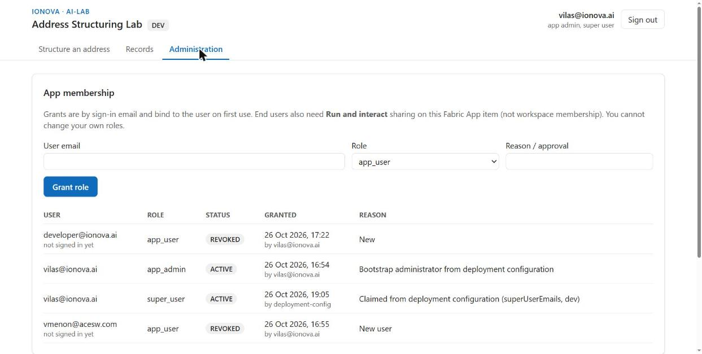

**Super user (dev and uat only).** An account listed in the deployment's super-user setting can select **Claim super user** on this tab once. It adds the super\_user role (app\_user plus app\_admin) so one person can test end to end. Production refuses this setting.

## App B, the isolation test app

App B is a deliberately tiny second app with its own Fabric item, database and access list; it exists to prove that one app cannot see another app's data or users.

1. Open the App B URL and sign in (a separate sign-in from App A).
2. Type a short note into the box and select **Add test note**.
3. Reload the page: the note is still listed with its date and time, so it was saved in App B's own database.

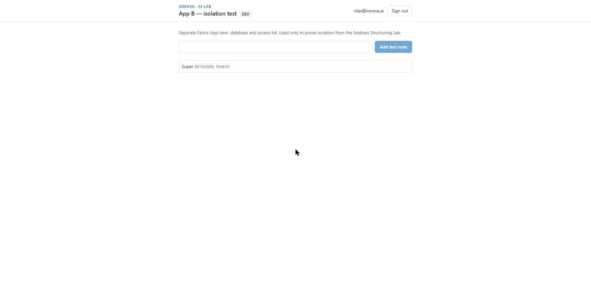

What it proved in dev (26 Oct 2026): App B's database holds only its notes table (1 note, “Super”), and App A's database has no notes table. Access is granted per app item, so a person shared on only one app cannot open the other.
